# SakuraReel 图文介绍

> 你的私人影视收藏。图片截自 SakuraReel 宣传片，按影片顺序排列。

## 看过 · 在看 · 想看

每一部，都收得好好的。首页按「看过 / 在看 / 想看」分类展示海报，卡片顺序可以自己调整。

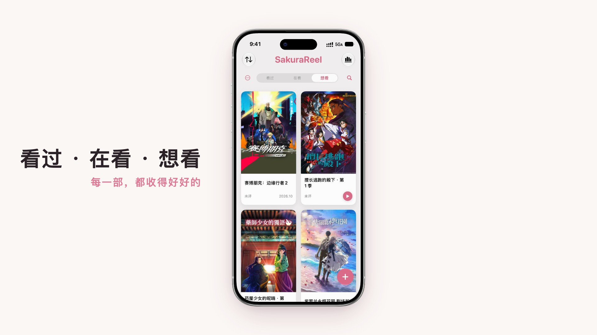

## 多端同步

支持通过 iCloud 文件夹多端同步：在首页菜单中选择同步文件夹，点击「同步」，只传输变化的部分。

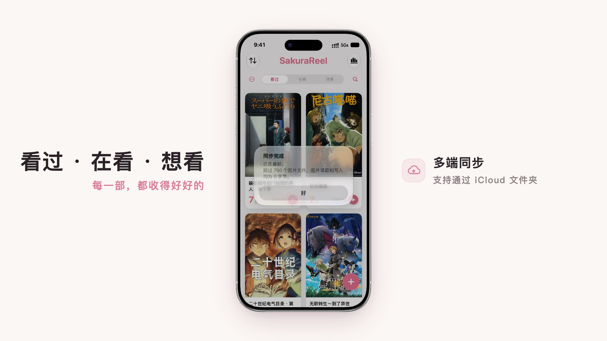

## 搜一下，就收下

使用 TMDB 的海量影视资料：

- 动画 · 剧集 · 电影，分类浏览
- 简 · 繁 · EN · 日，四种语言资料
- 按季导入，一季一条
- 海报、简介、演职员，一键导入
- 收进 看过 / 在看 / 想看

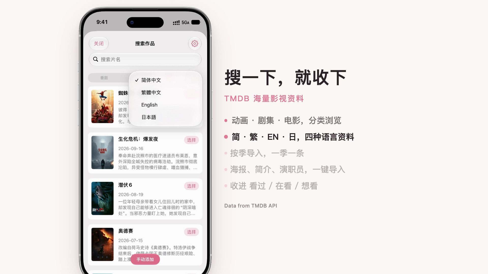

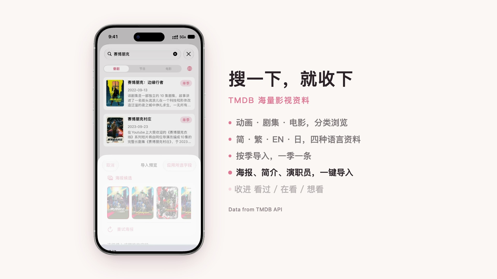

## 每一部，都有你的注脚

在一页里看完一部作品：官网、分享和播放入口，你的评分与短评，剧情简介、作品资料、单集列表、演员与职员。

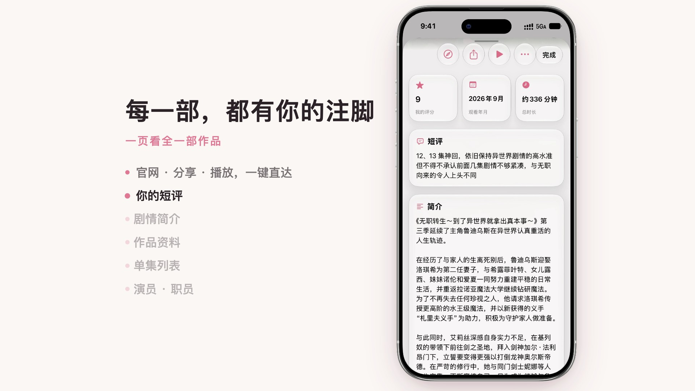

## 只属于你的排行榜

按你的评分排序。无论是主页还是排行榜，你都可以自己拖动卡片来调整顺序。

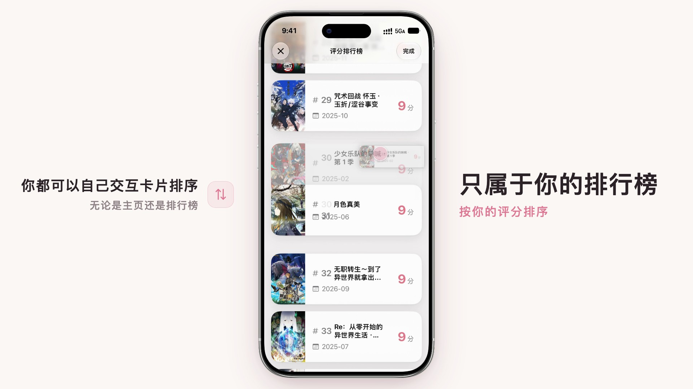

## 时光机

长按首页标题，进入时光机。

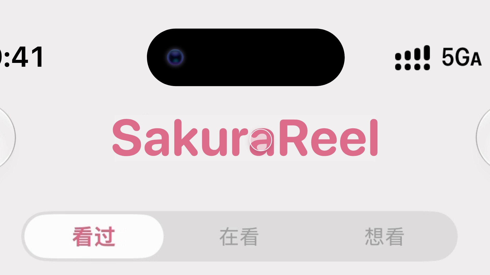

按季度回看你看过的作品。那年夏天，你在看什么？

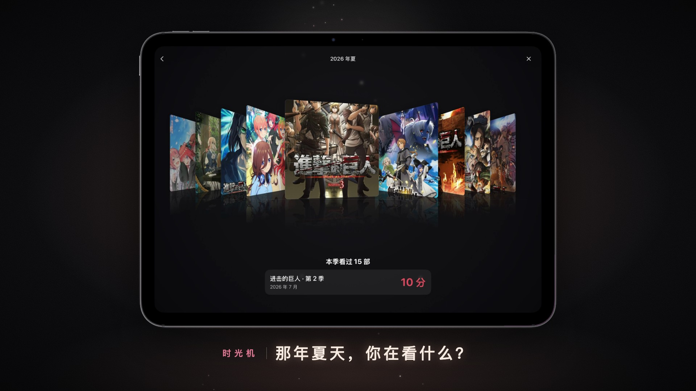

点一下中间的海报，卡片翻过来，就是当时写下的短评。

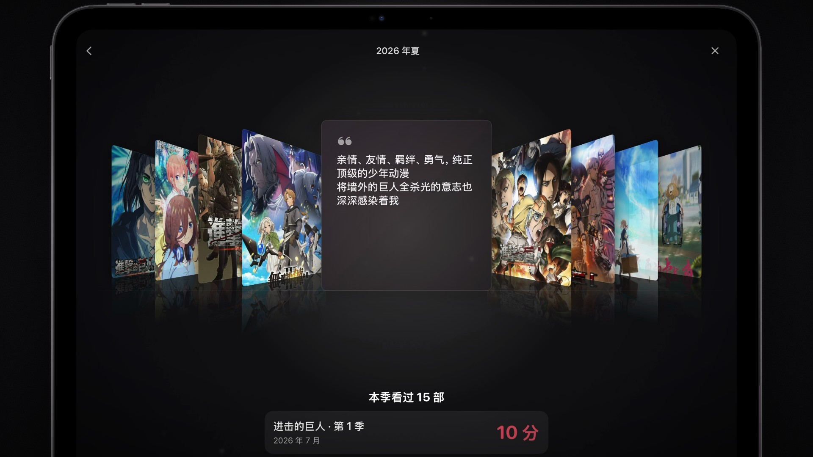

## 时光会走，回忆留下

*Blossoms fade. Memories don't.*

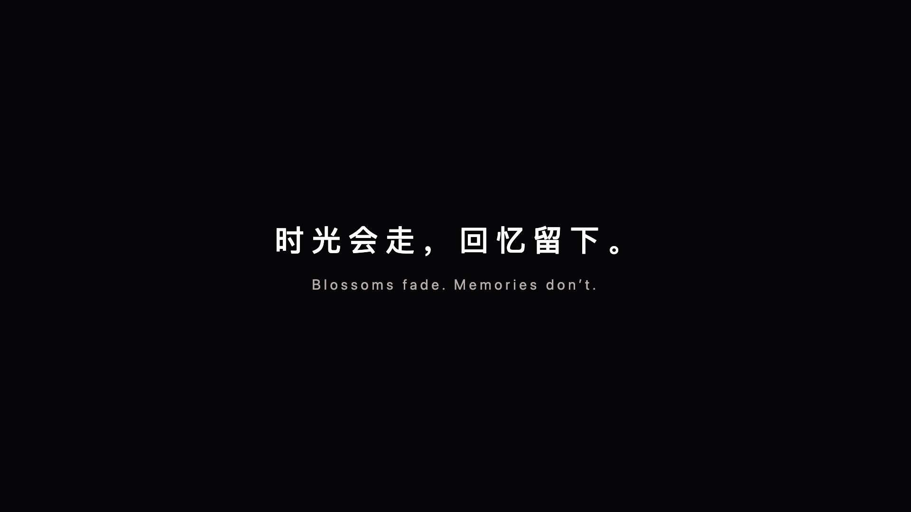

支持 iPhone · iPad · Mac，Android 与 Windows 版即将推出。

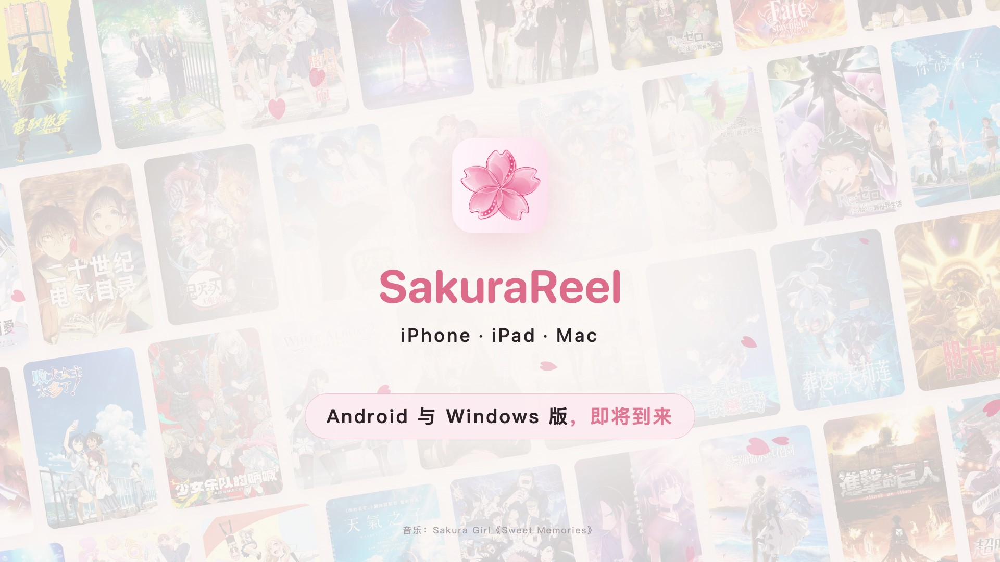

---

影视资料来自 [TMDB API](https://www.themoviedb.org/)。宣传片配乐：Sakura Girl《Sweet Memories》。
